<h1 align="center">🐾 Paw oh Paw</h1>

<p align="center"><b>걷는 영상 하나로 반려견의 보행을 숫자로 봅니다</b></p>

<p align="center"></p>

<p align="center">
동물병원에서 반려견이 걷는 모습을 휴대폰으로 찍으면,<br>
AI가 관절점을 찾아 좌우 차이를 재고 보고서까지 만들어 줍니다.
</p>

<p align="center">
<a href="https://k15a404.p.ssafy.io/web"><b>병원용 웹 열기</b></a> (PC)
&nbsp;·&nbsp;
<a href="https://k15a404.p.ssafy.io/welcome"><b>촬영 앱 열기</b></a> (휴대폰)
</p>

<p align="center">
<a href="#-왜-만들었나요">왜 만들었나요</a> ·
<a href="#-이렇게-씁니다">이렇게 씁니다</a> ·
<a href="#-주요-화면">주요 화면</a> ·
<a href="#-이렇게-풀었습니다">이렇게 풀었습니다</a> ·
<a href="#-구조">구조</a> ·
<a href="#-기술-스택">기술 스택</a> ·
<a href="#-실행해-보기">실행해 보기</a> ·
<a href="#-팀">팀</a>
</p>

<p align="center"><sub>크림오프 x SSAFY 15기 서울 4반 A404팀 · 기업 연계 프로젝트 · 2026.10.06 ~ 2026.11.18</sub></p>

---

## 🐶 왜 만들었나요

| 눈으로는 놓칩니다 | 장비는 비쌉니다 | 그래서 영상을 봅니다 |
| :--- | :--- | :--- |
| 관절이 불편한 개는 아프다고 말하지 못하고 걷는 모습을 조금 바꿉니다. 그 차이는 작아서 눈으로는 놓치기 쉽습니다. | 걸음을 정밀하게 재는 전문 장비는 비싸서 일부 큰 병원에만 있습니다. | 크림오프의 AI는 휴대폰 영상 속 **관절점 22개**로 다리마다 관절 각도와 좌우 차이를 잽니다. |

AI만으로는 병원에서 쓰기 어렵습니다. 영상을 찍어 옮기고, 숫자를 읽기 쉬운 결과로 바꾸고, 지난 측정과 비교하는 일이 남기 때문입니다.

**Paw oh Paw는 촬영부터 분석, 보고서, 경과 관리까지를 병원에서 쓰는 한 흐름으로 이었습니다.**

## 📱 이렇게 씁니다

반려견 한 마리를 한 번 재는 것을 **회차**라고 부릅니다. 한 회차에 4초짜리 영상을 16개까지 올리고, 그 영상들로 보고서 하나를 만듭니다.

### 1. PC에 QR을 띄우고 휴대폰으로 찍습니다

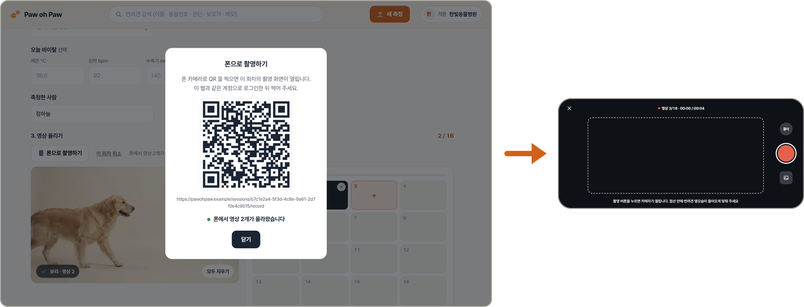

- 병원 PC의 웹에서 반려견을 고르고 **폰으로 촬영하기**를 누르면 QR이 뜹니다.
- 같은 계정으로 로그인한 휴대폰으로 QR을 찍으면 그 회차의 촬영 화면이 바로 열립니다.
- 휴대폰을 가로로 들고 점선 안에 옆모습을 맞춰 4초씩 찍으면, 찍은 영상이 PC 화면에 바로 나타납니다.

> 휴대폰으로 찍은 영상을 PC로 옮겨서 올리는 번거로움이 없습니다. 안드로이드 앱만으로도 같은 흐름으로 촬영할 수 있고, PC에 있는 영상 파일을 직접 올릴 수도 있습니다.

### 2. 영상이 차면 분석이 이어집니다

| 영상 채우기 | 분석 | 결과 |
| :---: | :---: | :---: |
| 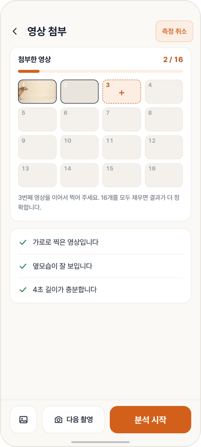 | 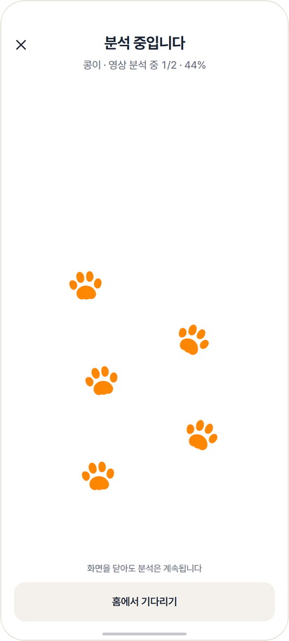 | 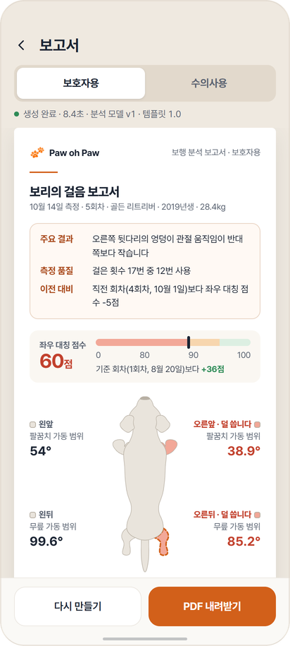 |
| 올릴 때마다 서버가 형식과 길이를 먼저 검사합니다 | 화면을 닫아도 분석은 계속됩니다 | 분석이 끝나면 휴대폰에서도 결과를 봅니다 |

### 3. 읽는 사람에 맞춰 보고서를 두 가지로 만듭니다

| 보호자용 | 수의사용 |
| :---: | :---: |
| 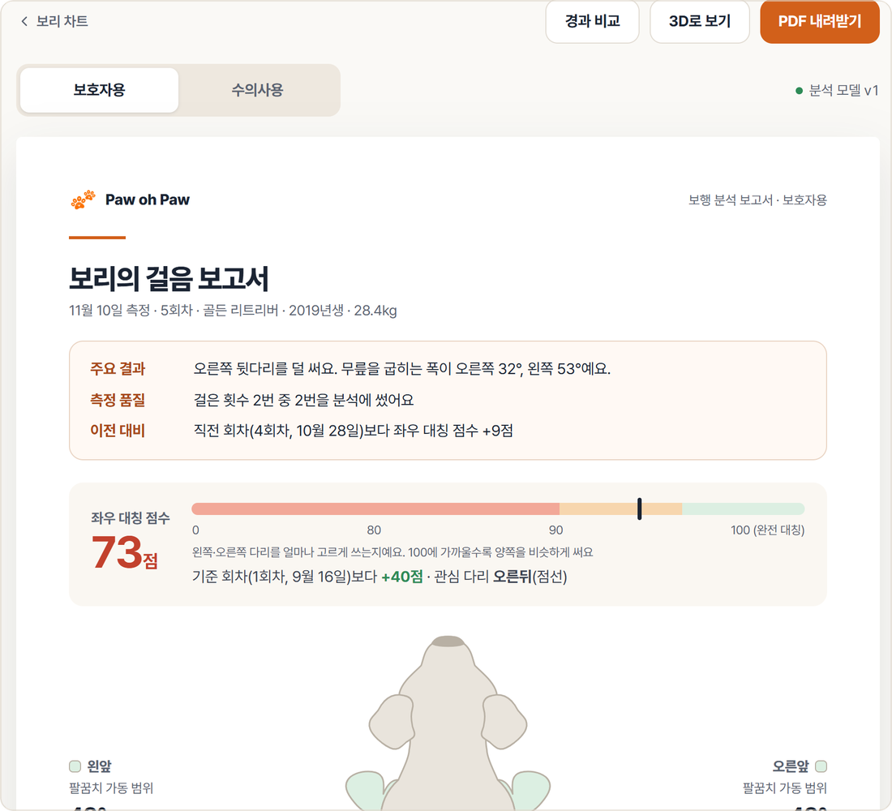 | 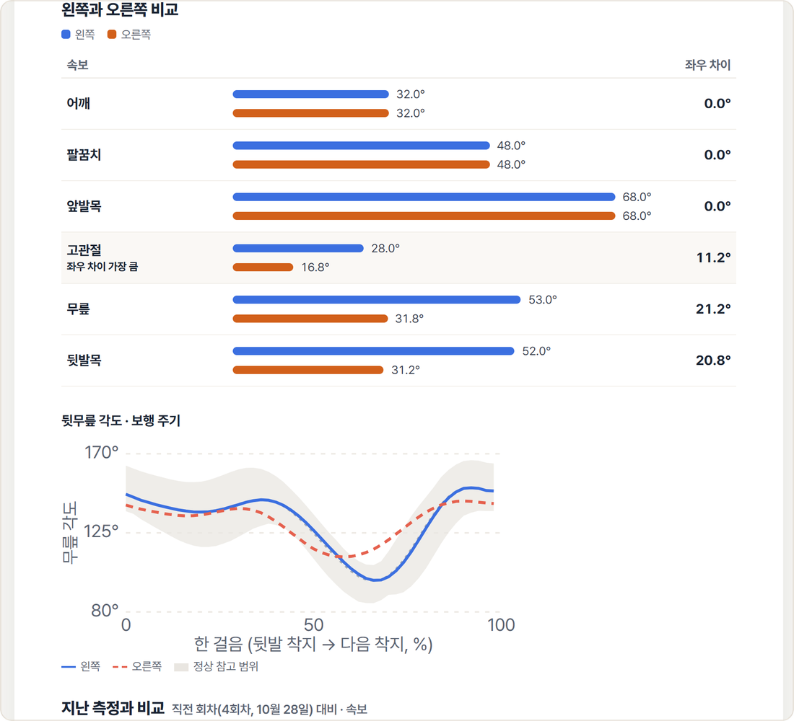 |
| 어느 다리가 다른지부터 보여 줍니다. 어려운 용어 없이 좌우 차이가 가장 큰 항목과 집에서 도와줄 수 있는 것을 담습니다 | 먼저 볼 관절이 위에 옵니다. 관절별 좌우 비교, 걸음 한 번 동안의 무릎 각도 곡선, 지난 측정과의 차이를 담습니다 |

측정이 끝나면 두 가지 모두 PDF로 자동으로 만들어집니다.

## 💻 주요 화면

수의사가 매일 쓰는 진료 기록 프로그램(EMR)과 같은 자리에 같은 정보를 두었습니다. 새로 배우지 않아도 어디를 봐야 하는지 알 수 있습니다.

| 홈 | 반려견 차트 |
| :---: | :---: |
| 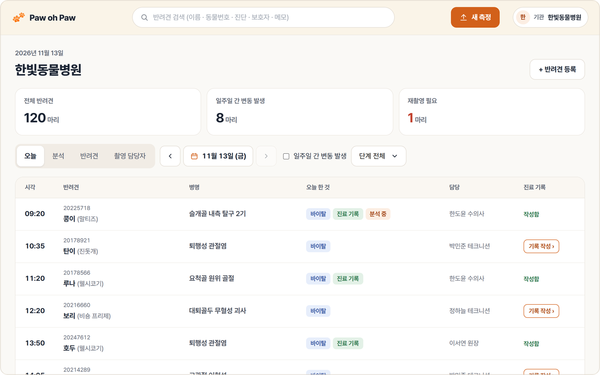 | 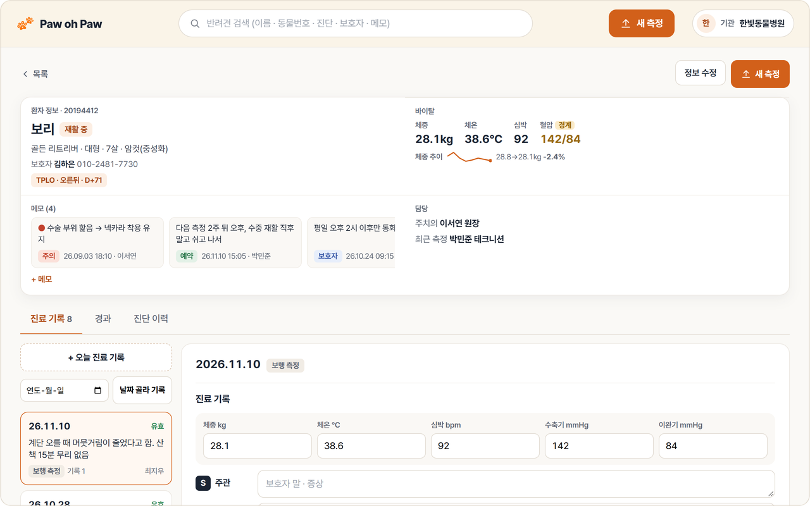 |
| 그날 할 일을 한 화면에 모았습니다. 변동이 생겼거나 재촬영이 필요한 반려견만 골라 봅니다 | 환자 정보, 바이탈, 메모, 진료 기록, 진단 이력을 측정 이력과 함께 봅니다 |

| 경과 비교 | 3D 보기 |
| :---: | :---: |
| 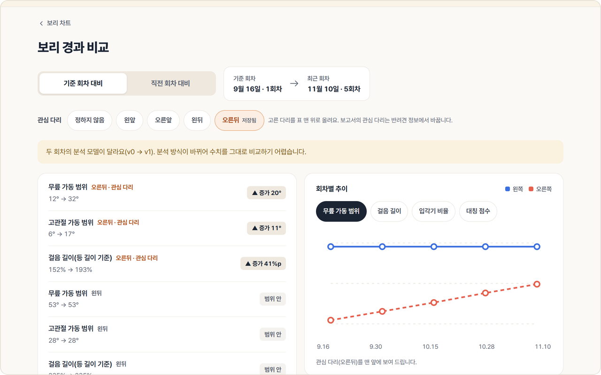 | 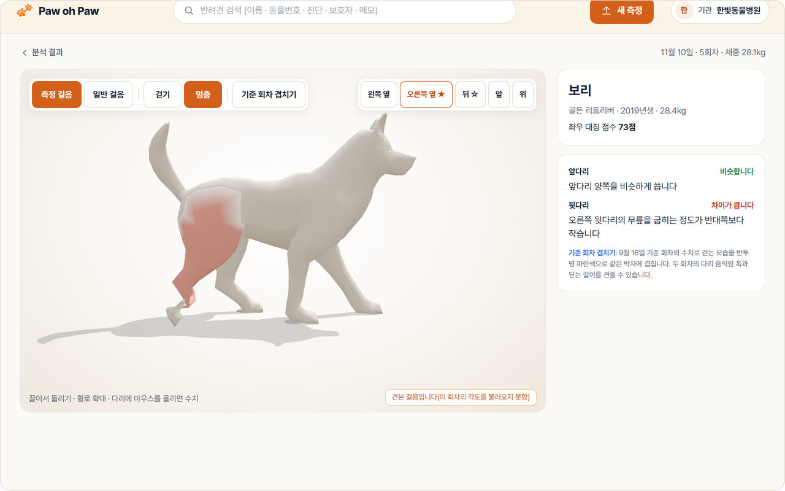 |
| 기준 회차나 직전 회차와 비교합니다. 오차 범위를 넘는 차이만 변화로 표시합니다 | 그 회차에서 잰 값으로 걷는 동작을 맞춘 시각화입니다. 덜 쓰는 다리를 색으로 칠합니다 |

그 밖에 이런 기능이 있습니다.

- **결과 영상**: 관절점을 골격으로 그린 영상을 만들고, 함께 찍힌 사람 얼굴은 자동으로 가립니다.
- **업로드 검사**: 영상을 올릴 때 형식과 길이를 비롯한 아홉 가지를 먼저 검사합니다.
- **기관과 계정**: 병원마다 자료가 분리됩니다. 기기 코드로 가입하고, 크림오프 관리자와 병원 담당자로 역할이 나뉩니다.
- **자료 관리**: 지운 반려견은 휴지통에 30일 동안 남고, 계약이 끝나면 90일 뒤 자료를 지웁니다.

## 💡 이렇게 풀었습니다

| 고민 | 해결 |
| :--- | :--- |
| 휴대폰으로 찍은 영상을 PC로 옮겨야 한다 | **QR 연결**: PC에 뜬 QR에 회차 주소를 담습니다. 같은 계정의 휴대폰이 QR을 찍으면 그 회차의 촬영 화면이 열리고, 올린 영상은 PC 화면에 바로 나타납니다 |
| 분석은 오래 걸리는데 화면은 기다릴 수 없다 | **뒤에서 처리**: API는 영상을 저장하고 바로 응답합니다. 분석 요청과 결과 저장은 워커가 맡고, 처리 상태가 DB에 남아 서버를 다시 켜도 이어집니다 |
| GPU는 한 곳인데 병원은 여러 곳이다 | **분석 줄**: 한 회차의 영상 16건을 한 묶음으로 보냅니다. 병원마다 줄에 설 수 있는 회차와 1시간에 접수하는 회차에 상한을 두어, 한 병원이 몰려도 다른 병원이 밀리지 않습니다 |
| 잴 때마다 숫자가 조금씩 다르다 | **오차 범위**: 같은 개를 다시 재도 생기는 흔들림을 미리 재 두고, 그보다 큰 차이만 변화로 표시합니다 |
| 보고서가 진단처럼 읽히면 안 된다 | **문장 검사**: 진단처럼 읽히는 표현과 보호자에게 어려운 전문 용어를 자동으로 걸러 내고, 실린 숫자는 분석 결과와 자동으로 대조합니다 |
| 영상에 사람 얼굴이 찍힌다 | **얼굴 가리기**: 결과 영상을 만들 때 사람 얼굴을 찾아 자동으로 가립니다 |

## 🧭 구조

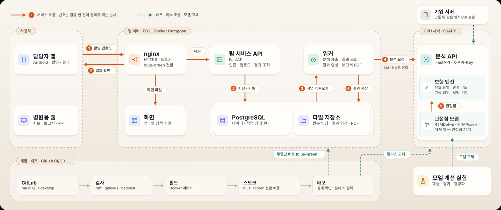

주황색 번호가 촬영 한 건이 결과가 되는 순서입니다.

| 구성요소 | 하는 일 | 폴더 |
| :--- | :--- | :--- |
| 촬영 앱 | 휴대폰에서 촬영, 업로드, 결과 확인 | `frontend/` |
| 병원용 웹 | PC에서 차트, 보고서, 경과 비교, 관리 | `web/` |
| 팀 서비스 API | 로그인, 병원별 자료 분리, 업로드 검사, 결과 조회 | `backend/app/api/` |
| 워커 | 분석 요청과 결과 저장, 결과 영상과 보고서 PDF 만들기 | `backend/app/worker/` |
| 분석 API | 영상을 받아 관절점과 보행 수치를 돌려줌 (GPU 서버) | `analysis_api/` |
| 보행 엔진 | 관절 각도, 유효 판별, 보행 수치 계산 | `engine/` |
| 관절점 모델 | 개 찾기(RTMDet-m)와 관절점 22개 찾기(RTMPose-m) | 가중치는 저장소에 없음 |

더 자세한 흐름은 아래를 펼쳐 보세요.

<details>
<summary><b>촬영 한 건이 분석되는 흐름</b></summary>

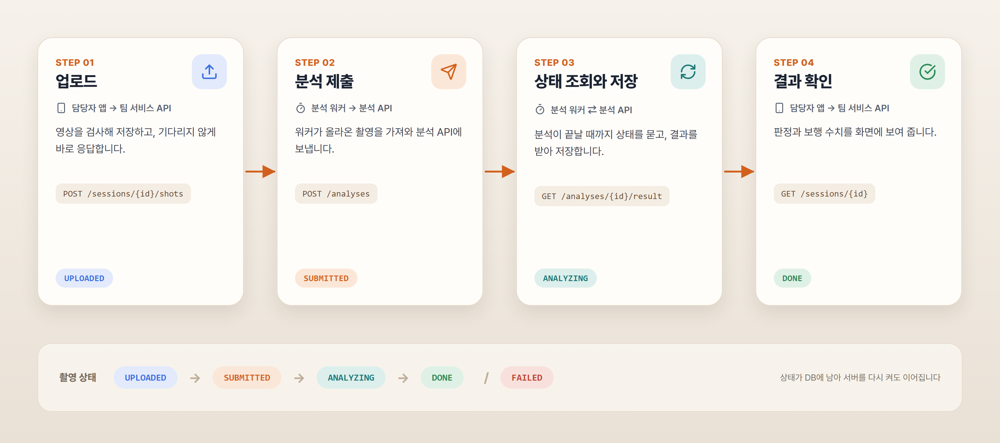

| 단계 | 하는 일 | 코드 |
| :--- | :--- | :--- |
| 업로드 | 영상을 검사해 저장하고, 촬영을 `UPLOADED`로 기록한 뒤 바로 응답합니다 | `backend/app/services/uploads.py` |
| 분석 제출 | 워커가 `UPLOADED` 촬영을 가져와 `SUBMITTED`로 바꾸고 분석 API에 보냅니다 | `backend/app/worker/main.py` |
| 상태 조회 | 분석이 끝날 때까지 상태를 확인하고, 결과를 받으면 `DONE`으로 저장합니다 | `backend/app/services/analysis_results.py` |
| 결과 확인 | 앱과 웹이 회차를 조회해 판정과 결과를 보여 줍니다 | `backend/app/api/routes/sessions.py` |

- 제출에 실패하면 다시 보내고, 제한 시간을 넘기면 `FAILED`로 마칩니다.
- 분석 API는 설정으로 모델을 바꿀 수 있고, 결과마다 어떤 모델로 분석했는지 남깁니다. 모델이 다른 회차끼리는 변화를 판단하지 않습니다.

</details>

<details>
<summary><b>GPU가 밀리지 않게 하는 분석 줄</b></summary>

분석은 GPU 서버 한 곳에서 합니다. 한 병원이 한꺼번에 많이 올려도 다른 병원이 오래 기다리지 않게 워커가 순서를 관리합니다.

- 잘못된 영상은 올릴 때 서버가 먼저 걸러 GPU까지 가지 않습니다.
- 분석 API에 한꺼번에 맡기는 양은 영상 16건, 한 회차 분량입니다.
- 병원마다 분석 줄에 설 수 있는 회차는 4개까지이고, 줄에 선 순서대로 처리합니다.
- 병원마다 1시간에 접수하는 회차는 10개까지입니다.

</details>

<details>
<summary><b>관절점이 숫자가 되기까지</b></summary>


영상에서 개를 찾고, 관절점 22개를 찍고, 뒷다리 좌우가 뒤바뀐 구간을 바로잡은 뒤 보행 엔진이 수치를 계산합니다.

| 단계 | 내용 |
| :--- | :--- |
| 관절 각도 | 크림오프의 평가 도구와 같은 정의로 계산합니다 |
| 좌표 보정 | 바닥의 매트를 기준으로 카메라와의 거리와 기울기를 보정해, 걸음마다 숫자가 흔들리는 것을 줄입니다 |
| 유효 판별 | 쓸 수 있는 걸음만 고릅니다. 뺀 걸음마다 이유와 잰 값, 기준값을 함께 보여 줍니다 |
| 보행 수치 | 걸음 길이, 발이 땅에 닿아 있는 시간의 비율, 보행 속도, 관절 가동 범위, 좌우 대칭 |
| 회차 비교 | 같은 개를 다시 재도 생기는 흔들림을 미리 재 두고, 그보다 큰 차이만 변화로 표시합니다 |

</details>

<details>
<summary><b>배포와 모니터링</b></summary>

- 팀 서버에서는 nginx가 주소로 나눕니다. `/api/`는 팀 서비스 API로, `/web/`은 병원용 웹으로, 나머지는 촬영 앱 화면으로 갑니다.
- MR마다 GitLab CI가 돕니다: 검사(ruff, hadolint, gitleaks) → 빌드 → 스모크 → 배포.
- `develop`은 개발 환경에, `master`는 운영 환경에 배포됩니다. 운영 배포는 사람이 눌러야 나갑니다.
- 팀 서버는 blue-green 방식으로 무중단 전환합니다. 새 판이 상태 확인을 통과하지 못하면 이전 판이 그대로 서비스합니다.
- 서버 상태는 Prometheus와 Grafana로 봅니다(`infra/monitoring/`).

</details>

## 🔧 기술 스택

| 영역 | 기술 |
| :--- | :--- |
| 촬영 앱 | React 19, TypeScript, Vite, TanStack Query, Capacitor(안드로이드), PWA |
| 병원용 웹 | React 19, TypeScript, Vite, React Router, three.js(3D 보기) |
| 백엔드 | Python 3.11, FastAPI, SQLAlchemy, Alembic, PostgreSQL 17, OpenCV와 ffmpeg(결과 영상), Gotenberg와 WeasyPrint(보고서 PDF) |
| 분석 API, 보행 엔진 | Python, FastAPI |
| 관절점 모델 | PyTorch, MMPose (RTMDet-m, RTMPose-m) |
| 인프라 | Docker Compose, nginx, GitLab CI/CD, Prometheus, Grafana |

## 🚀 실행해 보기

### 배포된 서비스로 보기

| 구분 | 주소 | 계정 없이 둘러보기 |
| :--- | :--- | :--- |
| 병원용 웹 (PC) | <https://k15a404.p.ssafy.io/web> | 로그인 화면에서 **시연용 예시 기관으로 둘러보기** |
| 촬영 앱 (휴대폰) | <https://k15a404.p.ssafy.io/welcome> | 첫 화면에서 **서버 없이 둘러보기** |

둘러보기는 예시 데이터로 화면만 보여 줍니다. 실제 촬영과 분석은 기관에서 받은 기기 코드로 가입한 계정이 있어야 합니다.

### 내 PC에서 띄우기

백엔드와 GPU 없이 예시 데이터로 화면을 둘러볼 수 있습니다. Node.js가 필요합니다.

**병원용 웹**: `http://localhost:5174`의 로그인 화면에서 **시연용 예시 기관으로 둘러보기**를 누릅니다.

```bash
cd web
npm ci
npm run dev:mock
```

**촬영 앱**: `http://localhost:5173`의 로그인 화면에서 **서버 없이 둘러보기**를 누릅니다. PC 브라우저에서는 휴대폰 크기의 화면이 가운데에 뜹니다.

```bash
cd frontend
npm ci
cp .env.example .env.local
npm run dev
```

<details>
<summary><b>폴더별로 실행하기</b></summary>

| 폴더 | 포트 | 안내 |
| :--- | :--- | :--- |
| `backend/` | 8000 | [backend/README.md](backend/README.md) |
| `frontend/` | 5173 | [frontend/README.md](frontend/README.md) |
| `web/` | 5174 | [web/PORTING.md](web/PORTING.md) |
| `analysis_api/` | 8010 | [analysis_api/README.md](analysis_api/README.md) |
| `prototype/` | 8001 | [prototype/README.md](prototype/README.md) |
| `ai/experiments/` | - | [ai/experiments/README.md](ai/experiments/README.md) |

팀 서버 전체는 저장소 루트에서 `.env.example`을 `.env`로 복사해 채운 뒤 `bash infra/ci/deploy.sh`로 띄웁니다.

</details>

<details>
<summary><b>저장소 구조</b></summary>

```
S15P31A404/
├── backend/        팀 서비스 API와 워커 (FastAPI, PostgreSQL)
├── frontend/       촬영 앱 (React, Capacitor 안드로이드)
├── web/            병원용 웹 (React)
├── analysis_api/   분석 API (FastAPI, GPU 서버에서 실행)
├── engine/         보행 엔진: 관절 각도, 유효 판별, 보행 수치
├── ai/             모델 실험 (학습, 평가, 경량화, 데이터 준비)
├── prototype/      웹 시안을 옮긴 초기 시연용 사이트
├── infra/          nginx 설정, CI와 배포 스크립트, 모니터링
├── docs/           API 명세, 팀 규칙, 라벨링 기준, 측정 기록
├── tests/          보행 엔진 테스트
└── compose.yaml    팀 서버 배포 구성
```

</details>

## 📚 문서

| 문서 | 위치 |
| :--- | :--- |
| 팀 서비스 API 명세 | [docs/api-spec.md](docs/api-spec.md), [docs/openapi.yaml](docs/openapi.yaml) |
| 백엔드 기능 명세 | [backend/docs/backend-spec.md](backend/docs/backend-spec.md) |
| 분석 API 명세와 결과 형식 | [docs/analysisApi/apiSpec.md](docs/analysisApi/apiSpec.md), [docs/analysisApi/resultFormat.md](docs/analysisApi/resultFormat.md) |
| 보행 엔진 규칙 (유효 판별, 보행 수치, 대칭) | [docs/engine/](docs/engine/) |
| 화면 계획 | [docs/frontend/screenPlan.md](docs/frontend/screenPlan.md) |
| 측정 기록 (동시 처리, 결과 영상과 보고서 처리 시간) | [docs/report/](docs/report/) |
| 모델 평가와 학습, 라벨링 기준 | [docs/eval/](docs/eval/), [docs/training/](docs/training/), [docs/labeling/labelGuide.md](docs/labeling/labelGuide.md) |
| 커밋, 브랜치, MR, Jira 규칙 | [docs/convention/](docs/convention/) |

## 👥 팀

| 이름 | 맡은 일 |
| :--- | :--- |
| 김지윤 | QA, 라이선스 조사, 일일 보고서 제작 |
| 박규원 | 모델 개선(정확도, 경량화), 데이터와 라벨링, 촬영 앱, 병원용 웹 |
| 장준환 | 화면 디자인, AI 모델 실험, 영상 포트폴리오 제작 |
| 조영운 | 백엔드 (팀 서비스 API, 워커, 보고서) |
| 조유진 | 분석 API, 보행 엔진, 발표 및 멘토링 진행 |
| 허정원 | 인프라 (배포, CI/CD, 모니터링, GPU 서버) |

관절점 라벨링은 여섯 명이 함께 했습니다.

## 🔒 자료와 주의

- 크림오프의 자료(영상, 정답, 모델 가중치)는 저장소에 없습니다.
- 이 문서의 화면 사진은 시연용 예시 데이터로 찍었습니다. 실제 병원과 보호자의 정보가 아닙니다.
- 보고서와 수치는 보행 평가를 돕는 자료이며 수의사의 진단을 대신하지 않습니다. 3D 보기도 카메라 한 대의 영상으로 만든 시각화이고, 판단의 기준은 보고서 수치입니다.
- 3D 보기의 개 모형은 Quaternius의 공개 모델(CC0)입니다. 결과 영상에서 사람 얼굴을 가리는 검출 모델의 라이선스 조사는 [docs/report/faceDetectorLicense.md](docs/report/faceDetectorLicense.md)에 있습니다.
