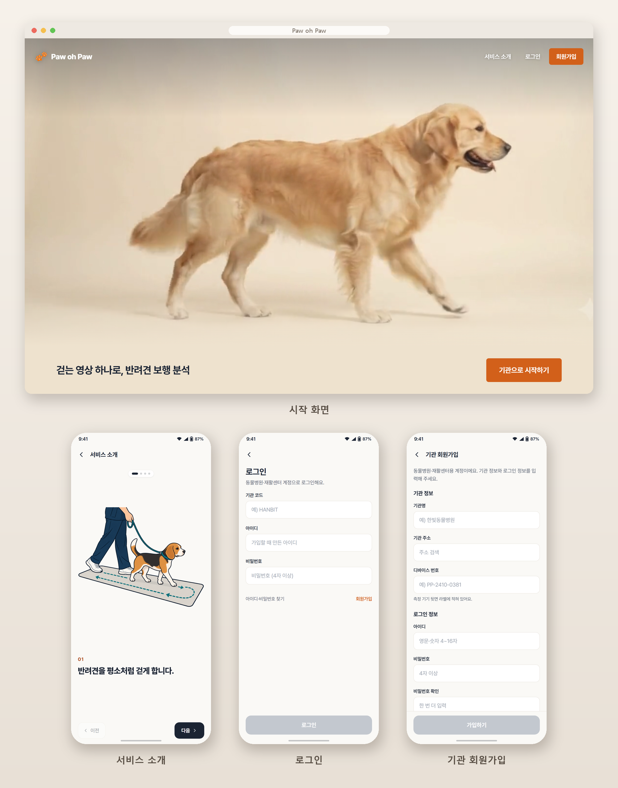
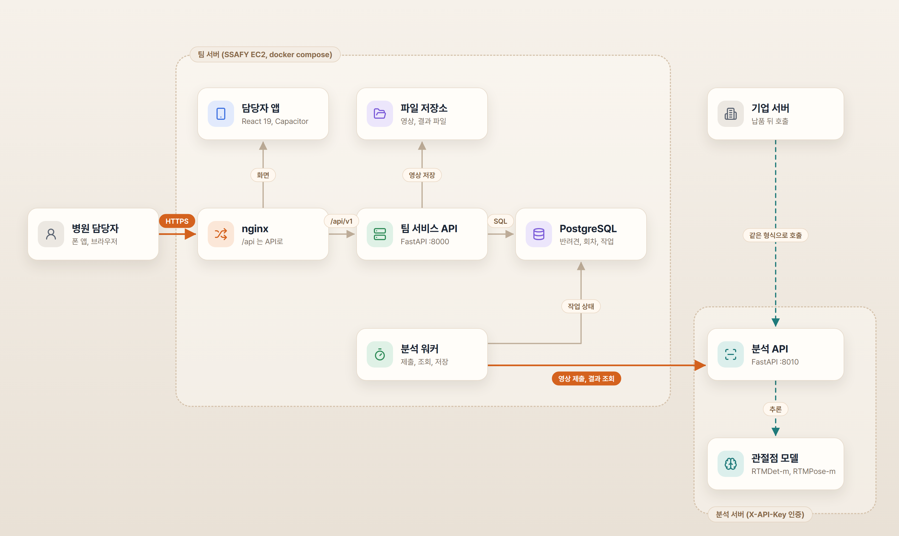
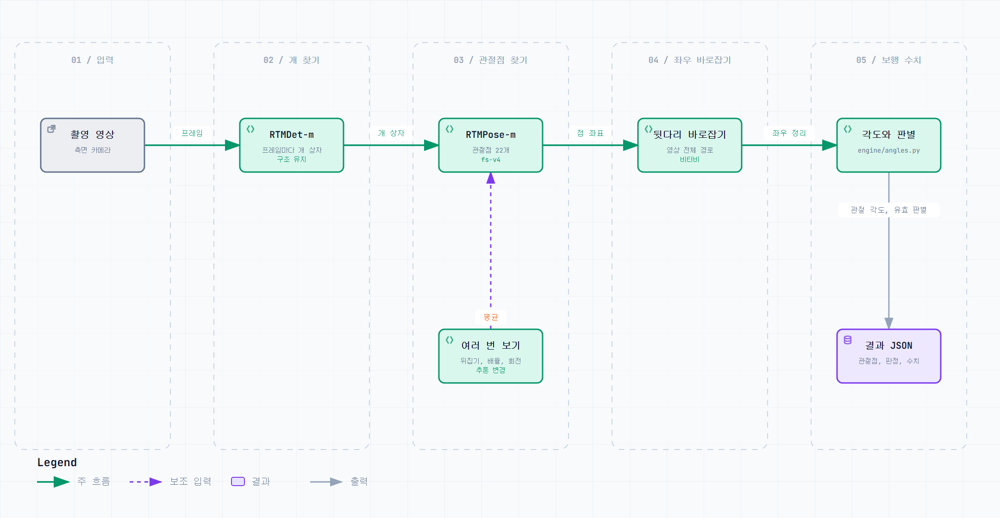

# 🐾 크림오프 x SSAFY

**반려견이 걷는 영상 한 편으로 관절 각도와 보행 수치를 재고, 보고서까지 만들어 드립니다.**



크림오프의 반려견 보행 분석 모델을 더 정확하고 가볍게 다듬고, 병원 담당자가 촬영부터 결과 확인까지 한곳에서 쓰는 서비스를 함께 만듭니다. SSAFY 15기 서울 4반 A404팀입니다.


| 영역 | 내용 |
| :--- | :--- |
| 모델 개선 | 기업 모델 구조(RTMDet-m + RTMPose-m)를 그대로 두고 정확도를 높이며 모델을 가볍게 만듭니다 |
| 분석 API | 영상 한 건을 받아 관절점, 유효 판별, 보행 수치를 돌려줍니다. 기업 서버도 같은 형식으로 호출합니다 |
| 팀 서비스 | 담당자가 반려견을 등록하고 회차별로 촬영을 올리면 분석 결과와 보고서를 확인할 수 있습니다 |

---

## 🧭 시스템 구성



- 담당자 앱과 팀 서비스 API는 팀 서버의 nginx 뒤에서 함께 동작합니다. `/api/` 요청은 API로, 나머지는 앱 화면으로 연결됩니다.
- 분석은 시간이 걸리므로 API가 직접 처리하지 않습니다. API가 촬영을 DB에 기록하면 분석 워커가 가져가 분석 API로 보냅니다.

## 🔄 촬영 한 건이 분석되는 흐름


| 단계 | 하는 일 | 코드 |
| :--- | :--- | :--- |
| 업로드 | 영상을 검사해 저장하고, 촬영을 `UPLOADED`로 기록한 뒤 바로 응답합니다 | `backend/app/services/uploads.py` |
| 분석 제출 | 워커가 `UPLOADED` 촬영을 가져와 `SUBMITTED`로 바꾸고 분석 API에 보냅니다 | `backend/app/worker/main.py` |
| 상태 조회 | 분석이 끝날 때까지 상태를 확인하고, 결과를 받으면 `DONE`으로 저장합니다 | `backend/app/services/analysis_results.py` |
| 결과 확인 | 앱이 회차를 조회해 판정과 결과를 보여 줍니다 | `backend/app/api/routes/sessions.py` |

처리 상태가 DB에 남아 있어 서버를 다시 시작해도 분석이 이어집니다. 제출에 실패하면 다시 보내고, 제한 시간을 넘기면 `FAILED`로 마칩니다.

## 🧠 관절점 분석 파이프라인



모델을 다시 학습시키지 않고 **추론 방식만 바꿔** 정확도를 높였습니다. 같은 사진을 뒤집고, 크기를 바꾸고, 살짝 기울여 여러 번 본 뒤 평균을 냅니다. 뒷다리 좌우가 뒤바뀐 구간은 영상 전체에서 가장 자연스러운 경로를 골라 바로잡습니다.

| 지표 | 기존 모델 | 현재 | 목표 |
| :--- | ---: | ---: | ---: |
| 관절 각도 평균 오차 (KPI-04) | 8.02° | **7.32°** | 7° 이하 |
| 뒷발끝 좌우 뒤바뀜 (KPI-21) | 13.0% | **5.9%** | 3.0% 이하 |
| 모델 파일 크기 (KPI-17) | 150.8 MiB | **75.5 MiB** | 100 MiB 이하 |

---

## 📁 저장소 구조

```
S15P31A404/
├── backend/        팀 서비스 API와 분석 워커 (FastAPI, PostgreSQL)
├── frontend/       담당자 앱 (React 19, Capacitor 안드로이드)
├── analysis_api/   분석 API (FastAPI)
├── engine/         관절 각도 계산, 카메라 방향, 유효 판별 규칙
├── ai/             모델 실험 (학습, 교차 실험, 의사 라벨, 속도 측정)
├── prototype/      웹 시안을 옮긴 시연용 사이트
├── infra/          nginx 설정, CI용 compose
├── docs/           API 명세, 컨벤션, 라벨링 기준, 평가 재현 기록
├── tests/          각도 계산, 카메라 방향, 정규화 테스트
└── compose.yaml    팀 서버 배포 (nginx, frontend, api, postgres, redis)
```

## 🚀 실행

폴더별 실행 방법은 각 README에 있습니다.

| 폴더 | 포트 | 안내 |
| :--- | :--- | :--- |
| `backend/` | 8000 | [backend/README.md](backend/README.md) |
| `frontend/` | 5173 | [frontend/README.md](frontend/README.md) |
| `analysis_api/` | 8010 | [analysis_api/README.md](analysis_api/README.md) |
| `prototype/` | 8001 | [prototype/README.md](prototype/README.md) |
| `ai/experiments/` | - | [ai/experiments/README.md](ai/experiments/README.md) |

팀 서버 전체는 저장소 루트에서 `.env`를 채운 뒤 `docker compose up -d --build`로 실행합니다.

## 📚 문서

| 문서 | 위치 |
| :--- | :--- |
| API 명세 | [docs/api-spec.md](docs/api-spec.md), [docs/openapi.yaml](docs/openapi.yaml) |
| 커밋, 브랜치, MR, Jira 규칙 | [docs/convention/](docs/convention/) |
| 라벨링 기준 | [docs/labeling/labelGuide.md](docs/labeling/labelGuide.md) |
| 유효 판별 규칙 | [docs/engine/validityRules.md](docs/engine/validityRules.md) |
| 기존 모델 평가 재현 | [docs/eval/fs-v4Reproduction.md](docs/eval/fs-v4Reproduction.md) |
| 학습 데이터 분할, 미세조정 | [docs/training/](docs/training/) |
| 화면 계획 | [docs/frontend/screenPlan.md](docs/frontend/screenPlan.md) |
| 라이선스 조사(얼굴 검출 모델, 결과 영상 코덱, 백엔드 라이브러리) | [docs/report/faceDetectorLicense.md](docs/report/faceDetectorLicense.md) |
| 결과 영상 처리 시간 측정(골격·얼굴 가리기) | [docs/report/renderTiming.md](docs/report/renderTiming.md) |
